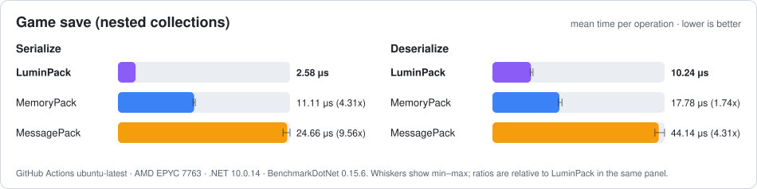
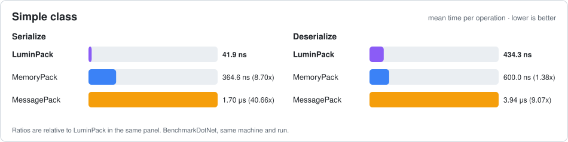
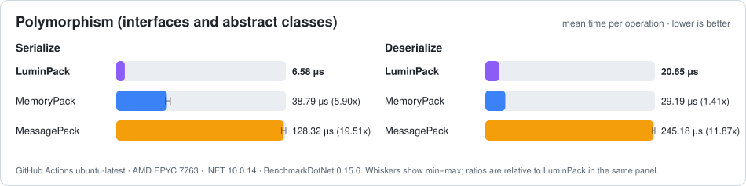
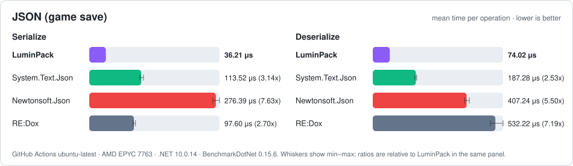

<div align="center">

# ✨ LuminPack

**面向 .NET 与 Unity 的极速二进制 & JSON 序列化库**

*零反射 · 零分配读取 · 原生支持 IL2CPP 与 NativeAOT*

[](https://www.nuget.org/packages/LuminPack)
[](https://www.nuget.org/packages/LuminPack)
[](LICENSE)
[](https://github.com/TheLight-233/LuminPack/stargazers)


[English](README.md) · **简体中文**

[快速开始](#-快速开始) ·
[特性](#-特性) ·
[文档](#-文档) ·
[基准测试](#-基准测试) ·
[平台扩展包](#-平台扩展包)

</div>

---

**LuminPack** 是一款 C# 高性能序列化库。只需给类型标上 `[LuminPackable]`，源代码生成器就会在编译期为它生成专属的二进制与 JSON 序列化代码——没有反射，没有运行时代码生成，也没有隐藏的内存分配。它为游戏存档、网络封包和实时系统而生，在每一微秒、每一个字节都很重要的场景里表现出色；同时它能运行在所有 .NET 平台上：从 .NET 11 服务器，到手机和主机上的 Unity IL2CPP。

```csharp
[LuminPackable]
public partial class Player
{
    public int Id;
    public string Name = "";
    public List<int> Scores = new();
}

byte[] bytes = LuminPackSerializer.Serialize(player);       // 🚀 二进制
LuminPackSerializer.Deserialize(bytes, ref player);          // ♻️ 填回原对象，零分配
string json = LuminPackSerializer.SerializeJson(player);     // 📜 同一个模型直接出 JSON
```

## 🌟 特性

<table>
<tr>
<td width="50%" valign="top">

### ⚡ 为速度而生
编译期为每个类型生成媲美手写的序列化代码。纯数据结构体直接按内存复制，字符串走向量化快速路径，热路径上不碰反射，也不查字典。

</td>
<td width="50%" valign="top">

### ♻️ 零分配读取
直接反序列化到你已有的对象里。List、数组、字典、嵌套对象以及没有变化的字符串都会被复用，预热后的读取可以做到完全不分配内存。

</td>
</tr>
<tr>
<td valign="top">

### 📦 一个模型，两种格式
一个特性同时得到两套完整格式：紧凑的二进制格式用于存储与网络传输，标准 JSON（UTF-8 或 UTF-16）用于配置、工具和 Web API。

</td>
<td valign="top">

### 📝 版本容忍
字段可以增加、删除、重排和重命名，旧存档照样能读。新旧版本的应用可以互相读取对方的数据。

</td>
</tr>
<tr>
<td valign="top">

### 🎭 好用的多态
接口和抽象类开箱即用：自动发现子类，支持泛型 case 和其他程序集中的类型，在 .NET 11 上还能识别 C# 15 的 `union` 类型。

</td>
<td valign="top">

### 🔗 真实的对象图
共享引用与循环引用、私有字段、构造函数、回调，以及你自己的实例池——LuminPack 能处理你真正会写出来的模型。

</td>
</tr>
<tr>
<td valign="top">

### 🎮 Unity 与 AOT 优先
支持 Unity Mono 与 IL2CPP、NativeAOT 以及完全裁剪。可选扩展包提供 Unity 值类型支持和 Burst 加速后端。

</td>
<td valign="top">

### 🔧 编译期配置
字符串编码、JSON 限制、可跨 32/64 位的结构体布局，以及面向不可信输入的加固模式，都在编译期选择。不开启的功能没有任何开销。

</td>
</tr>
<tr>
<td valign="top">

### 🪶 构建轻量
生成模式可以把生成代码裁剪到你真正序列化的类型，让大型项目依然编译飞快。

</td>
<td valign="top">

### 🌐 现代 I/O
`Span<T>`、`ReadOnlySequence<byte>`、`IBufferWriter<byte>`、Pipelines 和异步流都是一等公民。

</td>
</tr>
</table>

## 📦 安装

```shell
dotnet add package LuminPack
```

```xml
<PackageReference Include="LuminPack" Version="2.0.0" />
```

[`LuminPack`](https://www.nuget.org/packages/LuminPack) 会自动带上匹配版本的源代码生成器。支持 `netstandard2.1` 以及 `net8.0` – `net11.0`。

> 🎮 **使用 Unity？** 把 API 兼容级别设为 .NET Standard 2.1，然后参阅 [Unity 指南](docs/unity.cn.md)。

## 🚀 快速开始

```csharp
using LuminPack;
using LuminPack.Attribute;

[LuminPackable]
public partial class Person
{
    public int Age { get; set; }
    public string Name { get; set; } = "";
}

var person = new Person { Age = 18, Name = "Light" };

// 二进制
byte[] bytes = LuminPackSerializer.Serialize(person);
Person copy = LuminPackSerializer.Deserialize<Person>(bytes);

// JSON
string json = LuminPackSerializer.SerializeJson(person);
Person fromJson = LuminPackSerializer.DeserializeJson<Person>(json);
```

就这么简单——`LuminPackSerializer` 会生成到你的项目里，为你序列化的每个类型提供重载。缓冲区、流和 `IBufferWriter<byte>` 的用法见[快速开始](docs/getting-started.cn.md)。

## 🧭 功能速览

<details>
<summary><b>🎭 多态</b></summary>

```csharp
[LuminPackable]
public abstract partial class Shape { }

[LuminPackable] public sealed partial class Circle : Shape { public float Radius; }
[LuminPackable] public sealed partial class Square : Shape { public float Side; }

Shape shape = new Circle { Radius = 2 };
byte[] bytes = LuminPackSerializer.Serialize(shape);
Shape back = LuminPackSerializer.Deserialize<Shape>(bytes);   // Circle
```

➡️ [多态指南](docs/polymorphism.cn.md)
</details>

<details>
<summary><b>📝 版本容忍</b></summary>

```csharp
[LuminPackable(GeneratorType.VersionTolerant)]
public partial class SaveData
{
    public int Level;

    [LuminPackOldName("Name")]          // 从 Name 改名而来，旧存档照样能读
    public string DisplayName = "";

    public List<int> Unlocks = new();   // 后来新增的字段
}
```

➡️ [版本容忍指南](docs/versioning.cn.md)
</details>

<details>
<summary><b>♻️ 零分配复用与对象池</b></summary>

```csharp
var state = new WorldState();
while (running)
    LuminPackSerializer.Deserialize(ReceivePacket(), ref state);   // 每一帧都复用同一批对象

[LuminPackable]
public partial class Bullet
{
    public float X, Y;

    [LuminPackPoolRent]
    public static Bullet Rent() => BulletPool.Rent();               // 新实例从你的对象池中取
}
```

➡️ [复用指南](docs/reuse.cn.md)
</details>

<details>
<summary><b>🔗 共享引用与循环</b></summary>

```csharp
[LuminPackable(GeneratorType.CircleReference)]
public partial class Node
{
    [LuminPackOrder(0)] public Node? Parent;
    [LuminPackOrder(1)] public List<Node>? Children;
}
```

➡️ [引用跟踪](docs/versioning.cn.md#reference-tracking)
</details>

<details>
<summary><b>🔧 选项与可移植结构体</b></summary>

```csharp
[assembly: LuminPackOption(StringEncoding = LuminPackStringEncoding.UTF8)]

[LuminPackable, LuminPackOption(StructLayout = LuminPackStructLayout.Packed)]
public partial struct Packet            // 32 位和 64 位上字节完全一致
{
    public byte Kind;
    public long Sequence;
}
```

➡️ [选项指南](docs/options.cn.md)
</details>

## 📊 基准测试

在仓库的 CI 机器上使用 [BenchmarkDotNet](https://benchmarkdotnet.org) 测量——**越低越好**。每张图都在同一台机器、同一份数据、同一次运行中对比各个库；倍数表示该库耗时是 LuminPack 的多少倍，误差线表示最小值到最大值的范围。

| 🖥️ 测试环境 | |
| --- | --- |
| 运行环境 | GitHub Actions `ubuntu-latest`（[CI 工作流](.github/workflows/ci.yml)的 `Benchmark (linux-x64)` 任务） |
| CPU | AMD EPYC 7763 2.61 GHz · 2 核 / 4 线程 |
| 系统 | Ubuntu 24.04.5 LTS |
| 运行时 | .NET 10.0.14 · X64 RyuJIT（x86-64-v3 / AVX2） |
| 工具 | BenchmarkDotNet 0.15.6 · .NET SDK 11.0.100-rc.3 |
| 参数 | 四类基准均为 3 次启动 × 15 次迭代、8–30 次预热，TieredPGO 任务（启用分层编译与动态 PGO），使用 Server GC |

### 🎮 游戏存档

真实的存档数据，包含嵌套对象、List、字典和字符串。

<picture>
  <source media="(prefers-color-scheme: dark)" srcset="docs/assets/benchmarks/SerializeBenchmark-dark.svg">
  
</picture>

### 🧱 简单类

包含数字、数组、List 和字典的小型类——经典的微基准形态。

<picture>
  <source media="(prefers-color-scheme: dark)" srcset="docs/assets/benchmarks/SimpleBenchmark-dark.svg">
  
</picture>

### 🎭 多态

带有多个具体实现的接口与抽象类。

<picture>
  <source media="(prefers-color-scheme: dark)" srcset="docs/assets/benchmarks/PolymorphismBenchmark-dark.svg">
  
</picture>

### 📜 JSON

同一份游戏存档的 JSON 文本，与最流行的 .NET JSON 库对比。

<picture>
  <source media="(prefers-color-scheme: dark)" srcset="docs/assets/benchmarks/JsonBenchmark-dark.svg">
  
</picture>

想在自己的硬件上验证？可以在本地运行同样的四个基准类，也可以手动触发 CI 工作流并启用 `run_benchmarks`，从按主机分别保存的 `benchmark-artifacts-*` 中获取新结果：

```shell
dotnet run --project benchmarks/LuminPack.Benchmark -c Release -f net10.0 -- --filter "LuminPackBenchmark.SimpleBenchmark.*" "LuminPackBenchmark.SerializeBenchmark.*" "LuminPackBenchmark.JsonBenchmark.*" "LuminPackBenchmark.PolymorphismBenchmark.*"
```

## 📚 文档

| | 指南 | 内容 |
| :---: | --- | --- |
| 🚀 | [快速开始](docs/getting-started.cn.md) | 安装、第一个类型、所有入口、缓冲区与流 |
| 🎯 | [定义类型](docs/defining-types.cn.md) | 成员、顺序、构造、回调、大小担保、支持的类型 |
| 🎭 | [多态](docs/polymorphism.cn.md) | Union、泛型 case、其他程序集中的类型、手动注册 |
| 📝 | [版本容忍与引用跟踪](docs/versioning.cn.md) | 模型演进、成员重命名、共享对象与循环 |
| ♻️ | [复用与零分配](docs/reuse.cn.md) | 读入已有对象、实例池、输出缓冲区 |
| 🔧 | [编译期选项](docs/options.cn.md) | 字符串编码、选项配置、JSON 限制、32/64 位结构体布局 |
| 🪶 | [生成模式](docs/generation-modes.cn.md) | `Full`、`Medium`、`Light`、`Minimal` |
| ✍️ | [自定义格式化器](docs/custom-formatters.cn.md) | 手写格式、`Register<T>`、底层读写器 |
| 🎮 | [Unity、IL2CPP 与 NativeAOT](docs/unity.cn.md) | Unity 配置、Burst、裁剪 |
| 📐 | [数据格式](docs/formats.cn.md) | 二进制布局与 JSON 表示 |
| 🛡️ | [安全](docs/security.cn.md) | 可移植性、不可信输入、加密 |

## 🧩 平台扩展包

为引擎和 UI 类型提供开箱即用支持的可选扩展。核心库不依赖其中任何一个。

| 包 | 新增支持 |
| --- | --- |
| 🎮 [LuminPack.Unity](src/LuminPack.Unity/README.cn.md) | 向量、颜色、包围盒、矩阵、曲线、渐变 |
| 🔥 [LuminPack.Burst](src/LuminPack.Burst/README.cn.md) | Unity 上的 Burst 加速内核 |
| 🌐 [LuminPack.AspNetCore](src/LuminPack.AspNetCore/README.cn.md) | MVC 与 Minimal API 二进制请求体、HTTP 值类型 |
| 🖼️ [LuminPack.Avalonia](src/LuminPack.Avalonia/README.cn.md) | 几何、颜色、矩阵 |
| 🎨 [LuminPack.Drawing](src/LuminPack.Drawing/README.cn.md) | `System.Drawing.Color` |
| 📱 [LuminPack.Maui](src/LuminPack.Maui/README.cn.md) | MAUI Graphics 几何与颜色 |
| 🕹️ [LuminPack.MonoGame](src/LuminPack.MonoGame/README.cn.md) | 向量、矩阵、包围体 |
| 🖌️ [LuminPack.SkiaSharp](src/LuminPack.SkiaSharp/README.cn.md) | 几何、颜色、矩阵 |
| 🪟 [LuminPack.Wpf](src/LuminPack.Wpf/README.cn.md) | 几何、3D 类型、颜色 |

## 🤖 AI Skill

在用 AI 编程助手？[`skills/luminpack`](skills/luminpack/SKILL.md) 能教会它写出正确的 LuminPack 代码——特性、API、Union、版本容忍、自定义格式化器以及常见陷阱。把这个目录放进助手的 Skill 目录（例如 `.claude/skills/`）即可。

## 🤝 参与贡献

欢迎提交 Issue 和 Pull Request！请先阅读[贡献指南](CONTRIBUTING.cn.md)；[架构概览](docs/architecture.cn.md)和[设计约束](docs/mechanism-contract.cn.md)介绍了库的整体结构。

## 💖 致谢

LuminPack 早期从 [MemoryPack](https://github.com/Cysharp/MemoryPack) 的设计中学到了很多，此后沿着自己的方向独立演进。JSON 浮点数格式化移植自 [xjb](docs/xjb-NOTICE.md)。

## 📄 许可证

LuminPack 基于 [MIT 许可证](LICENSE)发布。第三方声明：[xjb 许可证](docs/xjb-LICENSE.txt)（Apache 2.0）· [xjb 声明](docs/xjb-NOTICE.md)。

<div align="center">

**如果 LuminPack 对你有帮助，欢迎在 GitHub 上点一个 ⭐！**

</div>
