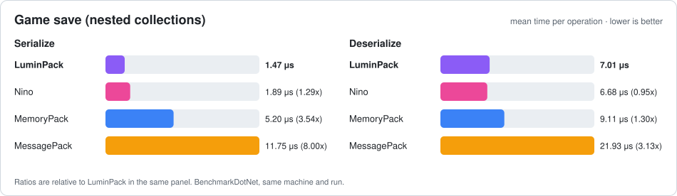
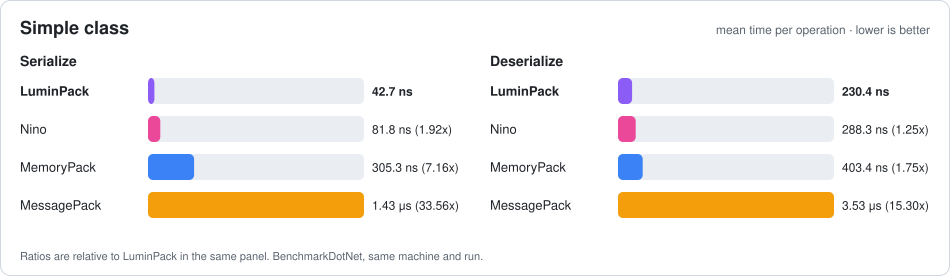
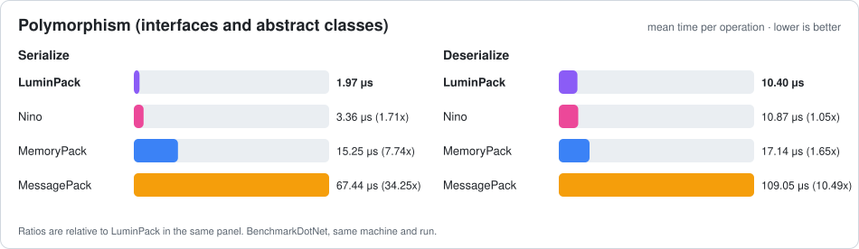
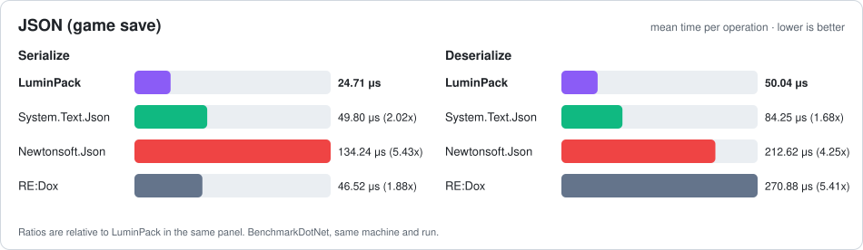
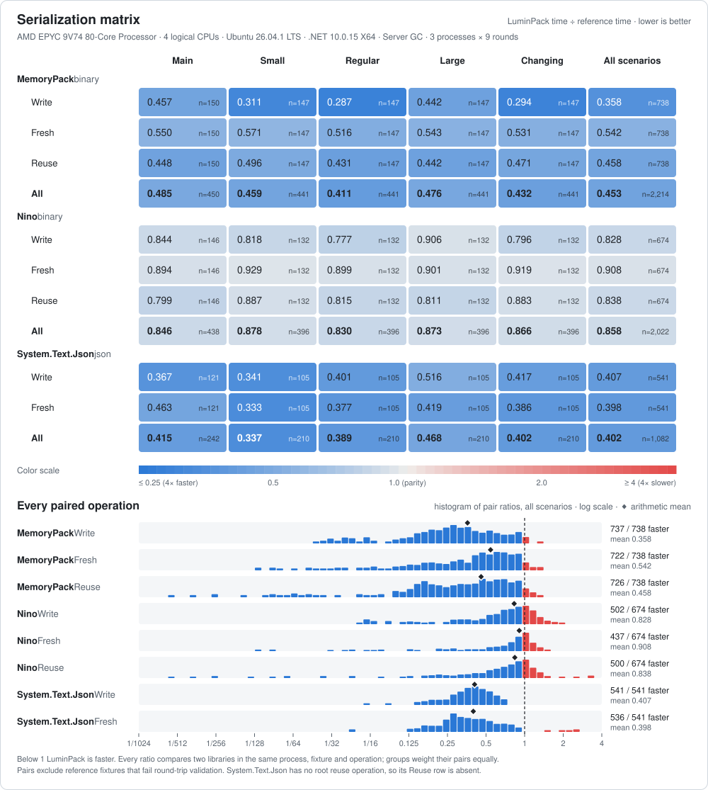

<div align="center">

# ✨ LuminPack

**Blazing-fast binary & JSON serialization for .NET and Unity**

*Zero reflection · Zero-allocation reads · Ready for IL2CPP and NativeAOT*

[](https://www.nuget.org/packages/LuminPack)
[](https://www.nuget.org/packages/LuminPack)
[](LICENSE)
[](https://github.com/TheLight-233/LuminPack/stargazers)


**English** · [简体中文](docs/README.cn.md)

[Quick Start](#-quick-start) ·
[Features](#-features) ·
[Documentation](#-documentation) ·
[Benchmarks](#-benchmarks) ·
[Platform Packages](#-platform-packages)

</div>

---

**LuminPack** is a high-performance serializer for C#. Mark a type with `[LuminPackable]` and a source generator writes a dedicated binary and JSON serializer for it at compile time — no reflection, no runtime code generation, no hidden allocations. It was built for game saves, network packets and real-time systems where every microsecond and every byte counts, and it runs everywhere .NET does: from .NET 11 servers down to Unity IL2CPP on consoles and phones.

```csharp
[LuminPackable]
public partial class Player
{
    public int Id;
    public string Name = "";
    public List<int> Scores = new();
}

byte[] bytes = LuminPackSerializer.Serialize(player);       // 🚀 binary
LuminPackSerializer.Deserialize(bytes, ref player);          // ♻️ refills the same object, zero allocation
string json = LuminPackSerializer.SerializeJson(player);     // 📜 JSON from the same model
```

## 🌟 Features

<table>
<tr>
<td width="50%" valign="top">

### ⚡ Built for speed
Every type gets hand-tuned-quality serialization code generated at compile time. Plain structs are copied straight from memory, strings take vectorized fast paths, and the hot path never touches reflection or dictionaries.

</td>
<td width="50%" valign="top">

### ♻️ Zero-allocation reads
Deserialize into the objects you already have. Lists, arrays, dictionaries, nested objects and unchanged strings are reused, so a warmed-up read can allocate nothing at all.

</td>
</tr>
<tr>
<td valign="top">

### 📦 Binary and JSON, one model
Two complete formats from a single annotation: a compact binary format for storage and the wire, and standard JSON (UTF-8 or UTF-16) for configs, tools and web APIs.

</td>
<td valign="top">

### 📝 Version tolerance
Add, remove, reorder and rename fields without breaking old saves. Old and new versions of your app read each other's data.

</td>
</tr>
<tr>
<td valign="top">

### 🎭 Polymorphism done right
Interfaces and abstract classes just work: subclasses are discovered automatically, generic cases and types from other assemblies are supported, and C# 15 `union` types are recognized on .NET 11.

</td>
<td valign="top">

### 🔗 Real object graphs
Shared references and cycles, private fields, constructors, callbacks and your own instance pools — LuminPack handles the models you actually write.

</td>
</tr>
<tr>
<td valign="top">

### 🎮 Unity and AOT first
Runs on Unity Mono and IL2CPP, NativeAOT and full trimming. Optional packages add Unity value types and a Burst-accelerated backend.

</td>
<td valign="top">

### 🔧 Configured at compile time
Choose string encodings, JSON limits, portable 32/64-bit struct layouts. Untrusted reads are checked by default; declared limits bound hostile input, and unbounded limits are compiled away.

</td>
</tr>
<tr>
<td valign="top">

### 🪶 Small builds
Automatic generation retains declared model graphs and the concrete entries required by your calls. Modern compilers bind those entries through interceptors.

</td>
<td valign="top">

### 🌐 Modern I/O
`Span<T>`, `ReadOnlySequence<byte>`, `IBufferWriter<byte>`, streams and async entry points are supported.

</td>
</tr>
</table>

## 📦 Installation

> [!IMPORTANT]
> LuminPack 2.0, the version this repository documents, is not on NuGet yet. The [`LuminPack`](https://www.nuget.org/packages/LuminPack) package on NuGet today is the 1.x line, which has a different API. Until 2.0 is published, reference the projects from source.

```xml
<ItemGroup>
  <ProjectReference Include="path/to/LuminPack/src/LuminPack.Core/LuminPack.Core.csproj" />
  <ProjectReference Include="path/to/LuminPack/src/LuminPack.Generator/LuminPack.Generator.csproj"
                    OutputItemType="Analyzer"
                    ReferenceOutputAssembly="false" />
</ItemGroup>
```

Once 2.0 is released, `dotnet add package LuminPack` installs the runtime and brings the matching source generator with it. Targets `netstandard2.1` and `net8.0` – `net11.0`. To try the packages locally, build release candidates as described in [Releasing](docs/releasing.md#build-a-candidate-locally).

> 🎮 **Unity?** Set the API compatibility level to .NET Standard 2.1 and follow the [Unity guide](docs/unity.md).

## 🚀 Quick Start

```csharp
using LuminPack;
using LuminPack.Attribute;

[LuminPackable]
public partial class Person
{
    public int Age { get; set; }
    public string Name { get; set; } = "";
}

var person = new Person { Age = 18, Name = "Light" };

// Binary
byte[] bytes = LuminPackSerializer.Serialize(person);
Person copy = null!;
LuminPackSerializer.Deserialize(bytes, ref copy);

// JSON
string json = LuminPackSerializer.SerializeJson(person);
Person fromJson = null!;
LuminPackSerializer.DeserializeJson(json, ref fromJson);
```

That's it — `LuminPackSerializer` is generated into your project with overloads for every type you serialize. See [Getting Started](docs/getting-started.md) for buffers, streams and `IBufferWriter<byte>`.

## 🧭 A Quick Tour

<details>
<summary><b>🎭 Polymorphism</b></summary>

```csharp
[LuminPackable]
public abstract partial class Shape { }

[LuminPackable] public sealed partial class Circle : Shape { public float Radius; }
[LuminPackable] public sealed partial class Square : Shape { public float Side; }

Shape shape = new Circle { Radius = 2 };
byte[] bytes = LuminPackSerializer.Serialize(shape);
Shape back = null!;
LuminPackSerializer.Deserialize(bytes, ref back);   // Circle
```

➡️ [Polymorphism guide](docs/polymorphism.md)
</details>

<details>
<summary><b>📝 Version tolerance</b></summary>

```csharp
[LuminPackable(GeneratorType.VersionTolerant)]
public partial class SaveData
{
    public int Level;

    [LuminPackOldName("Name")]          // renamed from Name, old saves still load
    public string DisplayName = "";

    public List<int> Unlocks = new();   // added later
}
```

➡️ [Version tolerance guide](docs/versioning.md)
</details>

<details>
<summary><b>♻️ Zero-allocation reuse and pooling</b></summary>

```csharp
var state = new WorldState();
while (running)
    LuminPackSerializer.Deserialize(ReceivePacket(), ref state);   // same objects every frame

[LuminPackable]
public partial class Bullet
{
    public float X, Y;

    [LuminPackPoolRent]
    public static Bullet Rent() => BulletPool.Rent();               // new instances come from your pool
}
```

➡️ [Reuse guide](docs/reuse.md)
</details>

<details>
<summary><b>🔗 Shared references and cycles</b></summary>

```csharp
[LuminPackable(GeneratorType.CircleReference)]
public partial class Node
{
    [LuminPackOrder(0)] public Node? Parent;
    [LuminPackOrder(1)] public List<Node>? Children;
}
```

➡️ [Reference tracking](docs/versioning.md#reference-tracking)
</details>

<details>
<summary><b>🔧 Options and portable structs</b></summary>

```csharp
[assembly: LuminPackOption(StringEncoding = LuminPackStringEncoding.UTF8)]

[LuminPackable, LuminPackOption(StructLayout = LuminPackStructLayout.Packed)]
public partial struct Packet            // identical bytes on 32-bit and 64-bit
{
    public byte Kind;
    public long Sequence;
}
```

➡️ [Options guide](docs/options.md)
</details>

## 📊 Benchmarks

Measured on GitHub Actions in [CI run 43699899116](https://github.com/TheLight-233/LuminPack/actions/runs/43699899116) (commit `ff599dc`) — **lower is better**. Each chart compares libraries on the same machine, data and run; the multiplier is each library's time relative to LuminPack.

| 🖥️ Test machine | |
| --- | --- |
| Runner | GitHub Actions `ubuntu-latest`, `Benchmark (linux-x64)` job of the [CI workflow](.github/workflows/ci.yml) |
| CPU | AMD EPYC 9V45 · 2 cores / 4 threads |
| OS | Ubuntu 26.04.1 LTS |
| Runtime | .NET 11.0.0 with Satori GC (Server GC) · X64 RyuJIT x86-64-v4 (AVX-512) |
| Tooling | BenchmarkDotNet 0.15.6 · .NET SDK 11.0.100 |
| Settings | `TieredPGO-Satori` job (tiered compilation and dynamic PGO) · 3 processes × 15 iterations, 8–30 warmups, outliers kept |
| Libraries | Nino 4.0.0-rc.7 · MemoryPack 1.21.4 · MessagePack 3.1.12 · System.Text.Json (in-box) · Newtonsoft.Json 13.0.4 · RE:Dox (CAPCOM.REDox 1.0.0) |

### 🎮 Game save

A realistic save file with nested objects, lists, dictionaries and strings.

<picture>
  <source media="(prefers-color-scheme: dark)" srcset="docs/assets/benchmarks/SerializeBenchmark-dark.svg">
  
</picture>

### 🧱 Simple class

A small class with integers, 100 transforms, a dictionary and polymorphic members — the classic micro-benchmark shape.

<picture>
  <source media="(prefers-color-scheme: dark)" srcset="docs/assets/benchmarks/SimpleBenchmark-dark.svg">
  
</picture>

### 🎭 Polymorphism

A list of 1,000 polymorphic objects cycling through 20 concrete types.

<picture>
  <source media="(prefers-color-scheme: dark)" srcset="docs/assets/benchmarks/PolymorphismBenchmark-dark.svg">
  
</picture>

### 📜 JSON

The same game save as JSON text, against the most popular .NET JSON libraries (System.Text.Json with a source-generated context).

<picture>
  <source media="(prefers-color-scheme: dark)" srcset="docs/assets/benchmarks/JsonBenchmark-dark.svg">
  
</picture>

### 🌍 Other hosts

The same run also measured an Arm64 and an Intel host. LuminPack time ÷ reference time, averaged over each suite's operations (`TieredPGO-Satori`); **below 1 means LuminPack is faster**.

| Host | Nino | MemoryPack | MessagePack | System.Text.Json | Newtonsoft.Json | RE:Dox |
| --- | ---: | ---: | ---: | ---: | ---: | ---: |
| Linux x64 · AMD EPYC 9V45 | 0.78 | 0.42 | 0.11 | 0.55 | 0.21 | 0.36 |
| Linux Arm64 · Neoverse-N2 | 0.79 | 0.37 | 0.10 | 0.57 | 0.22 | 0.35 |
| macOS x64 · Intel Core i7-8700B | 1.08 | 0.49 | 0.12 | 0.58 | 0.24 | 0.35 |

On the Intel macOS host, Nino is faster on the polymorphism suite: LuminPack takes 1.53× Nino's time to write and 1.37× to read. That host also showed the widest spread between processes.

### 🧮 Serialization matrix

Beyond four hand-picked models, the matrix times every fixture LuminPack supports against MemoryPack, Nino and System.Text.Json: 154 fixtures covering scalars, framework types, collections and model graphs, plus 51 collection families × value, string and object elements at three sizes (8, 256 and 4,096) and with changing values. Each cell is the mean of LuminPack ÷ reference over every valid pair; the histograms show all 5,318 pairs.

<picture>
  <source media="(prefers-color-scheme: dark)" srcset="docs/assets/benchmarks/matrix-dark.svg">
  
</picture>

The matrix ran in the same CI run on a separate `ubuntu-latest` runner (AMD EPYC 9V74, .NET 10.0.15, Server GC, tiered compilation off), 3 processes × 9 rounds with the library order shuffled every round. Pairs leave out fixtures where the reference fails its own round-trip validation (MemoryPack 28, Nino 92 and System.Text.Json 225 across the scenarios); System.Text.Json has no root reuse operation.

Want to see it on your own hardware? Run the same four benchmark classes locally, or dispatch the CI workflow with `run_benchmarks` enabled to get fresh results in the per-host `benchmark-artifacts-*` and `benchmark-matrix` uploads:

```shell
dotnet run --project benchmarks/LuminPack.Benchmark -c Release -- --filter "LuminPackBenchmark.SimpleBenchmark.*" "LuminPackBenchmark.SerializeBenchmark.*" "LuminPackBenchmark.JsonBenchmark.*" "LuminPackBenchmark.PolymorphismBenchmark.*"
```

## 📚 Documentation

| | Guide | You'll learn |
| :---: | --- | --- |
| 🚀 | [Getting Started](docs/getting-started.md) | Installation, the first type, every entry point, buffers and streams |
| 🎯 | [Defining Types](docs/defining-types.md) | Members, ordering, constructors, callbacks, size guarantees, supported types |
| 🎭 | [Polymorphism](docs/polymorphism.md) | Unions, generic cases, types from other assemblies, manual registration |
| 📝 | [Version Tolerance & References](docs/versioning.md) | Evolving schemas, renamed members, shared objects and cycles |
| ♻️ | [Reuse & Zero Allocation](docs/reuse.md) | Reading into existing objects, instance pools, output buffers |
| 🔧 | [Compile-time Options](docs/options.md) | String encodings, option profiles, JSON limits, 32/64-bit struct layouts |
| 🪶 | [Automatic Generation](docs/generation-modes.md) | Static interception, source wrappers and registered fallback |
| ✍️ | [Custom Formatters](docs/custom-formatters.md) | Hand-written formats, `Register<T>`, low-level reader and writer |
| 💡 | [IDE Code Fixes](docs/code-fixes.md) | Included quick actions for generator diagnostics and Fix All |
| 🎮 | [Unity, IL2CPP & NativeAOT](docs/unity.md) | Unity setup, Burst, trimming |
| 📐 | [Wire Formats](docs/formats.md) | The binary layout and the JSON representation |
| 🗜️ | [Compression](docs/compression.md) | `LuminCompressor`, `[LuminPackCompress]` and the `LUM2` frame |
| 🛡️ | [Security](docs/security.md) | Portability, untrusted input, encryption |

## 🧩 Platform Packages

Optional add-ons with ready-made support for engine and UI types. The core library depends on none of them; for now they are referenced as source projects.

| Package | Adds support for |
| --- | --- |
| 🎮 [LuminPack.Unity](src/LuminPack.Unity/README.md) | Vectors, colors, bounds, matrices, curves, gradients |
| 🔥 [LuminPack.Burst](src/LuminPack.Burst/README.md) | Burst-accelerated kernels for Unity |
| 🌐 [LuminPack.AspNetCore](src/LuminPack.AspNetCore/README.md) | MVC and Minimal API binary bodies, HTTP value types |
| 🖼️ [LuminPack.Avalonia](src/LuminPack.Avalonia/README.md) | Geometry, colors, matrices |
| 🎨 [LuminPack.Drawing](src/LuminPack.Drawing/README.md) | `System.Drawing.Color` |
| 📱 [LuminPack.Maui](src/LuminPack.Maui/README.md) | MAUI Graphics geometry and colors |
| 🕹️ [LuminPack.MonoGame](src/LuminPack.MonoGame/README.md) | Vectors, matrices, bounding volumes |
| 🖌️ [LuminPack.SkiaSharp](src/LuminPack.SkiaSharp/README.md) | Geometry, colors, matrices |
| 🪟 [LuminPack.Wpf](src/LuminPack.Wpf/README.md) | Geometry, 3D types, colors |

## 🤖 AI Skill

Using an AI coding assistant? [`skills/luminpack`](skills/luminpack/SKILL.md) teaches it to write correct LuminPack code — attributes, APIs, Unions, version tolerance, custom formatters and the common pitfalls. Drop the folder into your assistant's skill directory (for example `.claude/skills/`) and you're set.

## 🤝 Contributing

Issues and pull requests are welcome! Please read the [contributing guide](CONTRIBUTING.md) first; it covers building, checks, benchmarks and the contributor references, including the [architecture overview](docs/architecture.md) and the [design rules](docs/mechanism-contract.md). Coding agents read [AGENTS.md](AGENTS.md).

## 💖 Acknowledgements

LuminPack learned a great deal from the design of [MemoryPack](https://github.com/Cysharp/MemoryPack) in its early days and has since grown in its own direction. Floating-point JSON formatting is ported from [xjb](docs/xjb-NOTICE.md).

## 📄 License

LuminPack is released under the [MIT License](LICENSE). Third-party notices: [xjb license](docs/xjb-LICENSE.txt) (Apache 2.0) · [xjb notice](docs/xjb-NOTICE.md).

<div align="center">

**If LuminPack helps you, a ⭐ on GitHub means a lot!**

</div>
