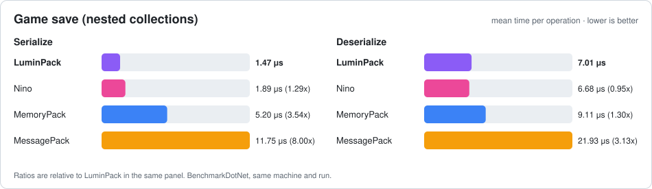
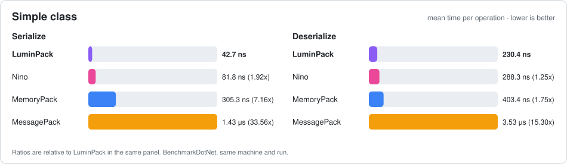
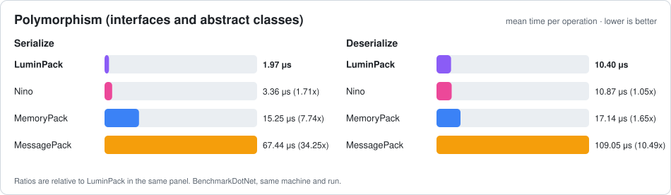
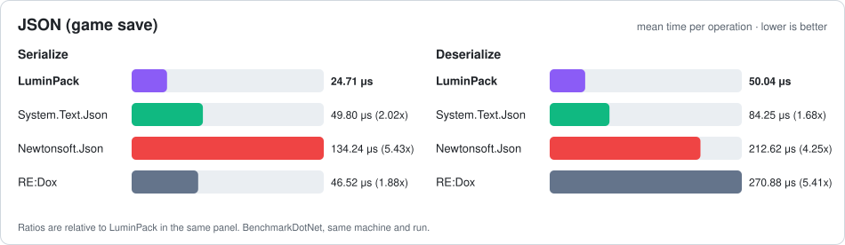
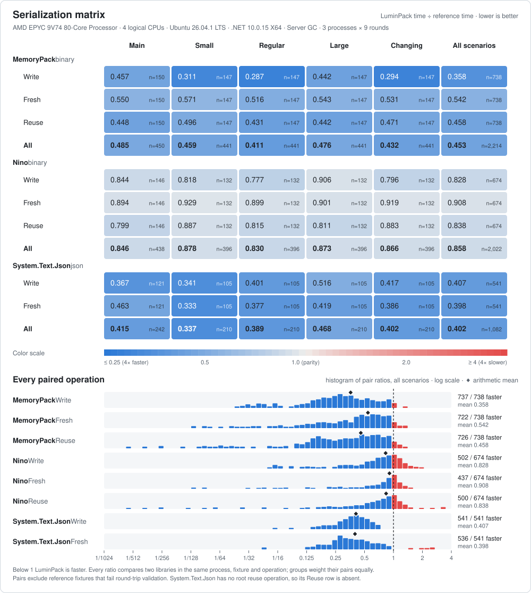

<div align="center">

# ✨ LuminPack

**面向 .NET、C++、Java、Go、TypeScript、Rust 与 Python 的二进制和 JSON 序列化库**

*共享数据契约 · .NET 源代码生成 · 支持 Unity 与 NativeAOT*

[](https://www.nuget.org/packages/LuminPack)
[](https://www.nuget.org/packages/LuminPack)
[](../LICENSE)
[](https://github.com/TheLight-233/LuminPack/stargazers)


[English](../README.md) · **简体中文**

[快速开始](#-快速开始) ·
[.NET 特性](#-net-特性) ·
[文档](#-文档) ·
[基准测试](#-基准测试) ·
[平台扩展包](#-平台扩展包)

</div>

---

**LuminPack** 是面向游戏存档、网络封包和实时应用的高性能序列化库。.NET 源代码生成器为 `[LuminPackable]` 类型构建二进制和 JSON 序列化器，并可导出同一份契约，为 C++、Java、Go、TypeScript、Rust 和 Python 生成绑定。各运行时按选定的模型和数据格式配置读写 LuminPack 文档。[跨语言指南](portable-runtime.cn.md)

| 语言 | 运行时指南 |
| --- | --- |
| C# | [.NET 与 Unity](getting-started.cn.md) |
| C++ | [C++20 运行时与生成的 codec](modules/luminpack.cpp.cn.md) |
| Java | [JDK 运行时与生成绑定](modules/luminpack.java.cn.md) |
| Go | [Go 模块与生成绑定](modules/luminpack.go.cn.md) |
| TypeScript | [TypeScript 运行时与生成类型](modules/luminpack.typescript.cn.md) |
| Rust | [强类型模型与原生文档](modules/luminpack.rust.cn.md) |
| Python | [编译式 dict/list 读写器与原生文档](modules/luminpack.python.cn.md) |

```csharp
[LuminPackable]
public partial class Player
{
    public int Id;
    public string Name = "";
    public List<int> Scores = new();
}

byte[] bytes = LuminPackSerializer.Serialize(player);       // 🚀 二进制
LuminPackSerializer.Deserialize(bytes, ref player);          // ♻️ 填回原对象，零分配
string json = LuminPackSerializer.SerializeJson(player);     // 📜 同一个模型直接出 JSON
```

## 🌟 .NET 特性

<table>
<tr>
<td width="50%" valign="top">

### ⚡ 为速度而生
编译期为每个类型生成媲美手写的序列化代码。纯数据结构体直接按内存复制，字符串走向量化快速路径，热路径上不碰反射，也不查字典。

</td>
<td width="50%" valign="top">

### ♻️ 零分配读取
直接反序列化到你已有的对象里。List、数组、字典、嵌套对象以及没有变化的字符串都会被复用，预热后的读取可以做到完全不分配内存。

</td>
</tr>
<tr>
<td valign="top">

### 📦 一个模型，两种格式
一个特性同时得到两套完整格式：紧凑的二进制格式用于存储与网络传输，标准 JSON（UTF-8 或 UTF-16）用于配置、工具和 Web API。

</td>
<td valign="top">

### 📝 版本容忍
字段可以增加、删除、重排和重命名，旧存档照样能读。新旧版本的应用可以互相读取对方的数据。

</td>
</tr>
<tr>
<td valign="top">

### 🎭 好用的多态
接口和抽象类开箱即用：自动发现子类，支持泛型 case 和其他程序集中的类型，在 .NET 11 上还能识别 C# 15 的 `union` 类型。

</td>
<td valign="top">

### 🔗 真实的对象图
共享引用与循环引用、私有字段、构造函数、回调，以及你自己的实例池——LuminPack 能处理你真正会写出来的模型。

</td>
</tr>
<tr>
<td valign="top">

### 🎮 Unity 与 AOT 优先
支持 Unity Mono 与 IL2CPP、NativeAOT 以及完全裁剪。可选扩展包提供 Unity 值类型支持和 Burst 加速后端。

</td>
<td valign="top">

### 🔧 编译期配置
字符串编码、JSON 限制和可跨 32/64 位的结构体布局都在编译期选择。不可信读取默认启用检查；声明限额可约束恶意输入，未声明的限额会被编译消除。

</td>
</tr>
<tr>
<td valign="top">

### 🪶 构建轻量
自动生成保留模型声明图和调用所需的具体入口；现代编译器通过 Interceptor 绑定这些入口。

</td>
<td valign="top">

### 🌐 现代 I/O
`Span<T>`、`ReadOnlySequence<byte>`、`IBufferWriter<byte>`、流和异步入口均受支持。

</td>
</tr>
</table>

## 📦 安装

> [!IMPORTANT]
> 本仓库介绍的 LuminPack 2.0 还没有发布到 NuGet。NuGet 上现有的 [`LuminPack`](https://www.nuget.org/packages/LuminPack) 包是 1.x 版本，API 与本仓库不同。在 2.0 发布之前，请直接引用源码项目。

```xml
<ItemGroup>
  <ProjectReference Include="path/to/LuminPack/src/LuminPack.Core/LuminPack.Core.csproj" />
  <ProjectReference Include="path/to/LuminPack/src/LuminPack.Generator.Next/LuminPack.Generator.Next.csproj"
                    OutputItemType="Analyzer"
                    ReferenceOutputAssembly="false" />
</ItemGroup>
```

`LuminPack` 2.0 包包含运行时、Next 源代码生成器、IDE 快速修复和 IL 重写工具。支持 `netstandard2.1` 以及 `net8.0` – `net11.0`，安装方法见[快速开始](getting-started.cn.md#安装)。

> 🎮 **使用 Unity？** 把 API 兼容级别设为 .NET Standard 2.1，然后参阅 [Unity 指南](unity.cn.md)。

## 🚀 快速开始

```csharp
using LuminPack;
using LuminPack.Attribute;

[LuminPackable]
public partial class Person
{
    public int Age { get; set; }
    public string Name { get; set; } = "";
}

var person = new Person { Age = 18, Name = "Light" };

// 二进制
byte[] bytes = LuminPackSerializer.Serialize(person);
Person copy = null!;
LuminPackSerializer.Deserialize(bytes, ref copy);

// JSON
string json = LuminPackSerializer.SerializeJson(person);
Person fromJson = null!;
LuminPackSerializer.DeserializeJson(json, ref fromJson);
```

就这么简单——`LuminPackSerializer` 会生成到你的项目里，为你序列化的每个类型提供重载。缓冲区、流和 `IBufferWriter<byte>` 的用法见[快速开始](getting-started.cn.md)。

## 🧭 功能速览

<details>
<summary><b>🎭 多态</b></summary>

```csharp
[LuminPackable]
public abstract partial class Shape { }

[LuminPackable] public sealed partial class Circle : Shape { public float Radius; }
[LuminPackable] public sealed partial class Square : Shape { public float Side; }

Shape shape = new Circle { Radius = 2 };
byte[] bytes = LuminPackSerializer.Serialize(shape);
Shape back = null!;
LuminPackSerializer.Deserialize(bytes, ref back);   // Circle
```

➡️ [多态指南](polymorphism.cn.md)
</details>

<details>
<summary><b>📝 版本容忍</b></summary>

```csharp
[LuminPackable, LuminPackOption(GeneratorType = GeneratorType.Version)]
public partial class SaveData
{
    public int Level;

    [LuminPackOldName("Name")]          // 从 Name 改名而来，旧存档照样能读
    public string DisplayName = "";

    public List<int> Unlocks = new();   // 后来新增的字段
}
```

➡️ [版本容忍指南](versioning.cn.md)
</details>

<details>
<summary><b>♻️ 零分配复用与对象池</b></summary>

```csharp
var state = new WorldState();
while (running)
    LuminPackSerializer.Deserialize(ReceivePacket(), ref state);   // 每一帧都复用同一批对象

[LuminPackable]
public partial class Bullet
{
    public float X, Y;

    [LuminPackPoolRent]
    public static Bullet Rent() => BulletPool.Rent();               // 新实例从你的对象池中取
}
```

➡️ [复用指南](reuse.cn.md)
</details>

<details>
<summary><b>🔗 共享引用与循环</b></summary>

```csharp
[LuminPackable, LuminPackOption(TrackReferences = true)]
public partial class Node
{
    public Node? Parent;
    public List<Node>? Children;
}
```

➡️ [引用跟踪](versioning.cn.md#reference-tracking)
</details>

<details>
<summary><b>🔧 选项与可移植结构体</b></summary>

```csharp
[assembly: LuminPackOption(StringEncoding = LuminPackStringEncoding.UTF8)]

[LuminPackable, LuminPackOption(StructLayout = LuminPackStructLayout.Packed)]
public partial struct Packet            // 32 位和 64 位上字节完全一致
{
    public byte Kind;
    public long Sequence;
}
```

➡️ [选项指南](options.cn.md)
</details>

## 📊 基准测试

数据来自 GitHub Actions 的 [CI 运行 43699899116](https://github.com/TheLight-233/LuminPack/actions/runs/43699899116)（提交 `ff599dc`）——**越低越好**。每张图都在同一台机器、同一份数据、同一次运行中对比各个库；倍数表示该库耗时是 LuminPack 的多少倍。

| 🖥️ 测试环境 | |
| --- | --- |
| 运行环境 | GitHub Actions `ubuntu-latest`，[CI 工作流](../.github/workflows/ci.yml)的 `Benchmark (linux-x64)` 任务 |
| CPU | AMD EPYC 9V45 · 2 核 / 4 线程 |
| 系统 | Ubuntu 26.04.1 LTS |
| 运行时 | .NET 11.0.0 + Satori GC（Server GC）· X64 RyuJIT x86-64-v4（AVX-512） |
| 工具 | BenchmarkDotNet 0.15.6 · .NET SDK 11.0.100 |
| 参数 | `TieredPGO-Satori` 任务（启用分层编译与动态 PGO）· 3 个进程 × 15 次迭代，8–30 次预热，保留离群值 |
| 对照库 | Nino 4.0.0-rc.7 · MemoryPack 1.21.4 · MessagePack 3.1.12 · System.Text.Json（运行时自带）· Newtonsoft.Json 13.0.4 · RE:Dox（CAPCOM.REDox 1.0.0） |

### 🎮 游戏存档

真实的存档数据，包含嵌套对象、List、字典和字符串。

<picture>
  <source media="(prefers-color-scheme: dark)" srcset="assets/benchmarks/SerializeBenchmark-dark.svg">
  
</picture>

### 🧱 简单类

包含整数、100 个 Transform、字典和多态成员的类——经典的微基准形态。

<picture>
  <source media="(prefers-color-scheme: dark)" srcset="assets/benchmarks/SimpleBenchmark-dark.svg">
  
</picture>

### 🎭 多态

包含 1,000 个元素的多态对象列表，循环使用 20 种具体类型。

<picture>
  <source media="(prefers-color-scheme: dark)" srcset="assets/benchmarks/PolymorphismBenchmark-dark.svg">
  
</picture>

### 📜 JSON

同一份游戏存档的 JSON 文本，与最流行的 .NET JSON 库对比（System.Text.Json 使用源生成上下文）。

<picture>
  <source media="(prefers-color-scheme: dark)" srcset="assets/benchmarks/JsonBenchmark-dark.svg">
  
</picture>

### 🌍 其他主机

同一次运行还测量了一台 Arm64 主机和一台 Intel 主机。下表为 LuminPack 耗时 ÷ 对照库耗时，按各套件的操作取平均（`TieredPGO-Satori`）；**小于 1 表示 LuminPack 更快**。

| 主机 | Nino | MemoryPack | MessagePack | System.Text.Json | Newtonsoft.Json | RE:Dox |
| --- | ---: | ---: | ---: | ---: | ---: | ---: |
| Linux x64 · AMD EPYC 9V45 | 0.78 | 0.42 | 0.11 | 0.55 | 0.21 | 0.36 |
| Linux Arm64 · Neoverse-N2 | 0.79 | 0.37 | 0.10 | 0.57 | 0.22 | 0.35 |
| macOS x64 · Intel Core i7-8700B | 1.08 | 0.49 | 0.12 | 0.58 | 0.24 | 0.35 |

在 Intel macOS 主机上，多态套件是 Nino 更快：LuminPack 的写入耗时是 Nino 的 1.53 倍，读取是 1.37 倍。这台主机的进程间波动也最大。

### 🧮 序列化矩阵

除了四个精选模型，矩阵还把 LuminPack 支持的每个 fixture 与 MemoryPack、Nino 和 System.Text.Json 逐一计时：154 个 fixture 覆盖标量、框架类型、集合和模型图，另有 51 类集合 × 值、字符串、对象元素，分三种规模（8、256、4,096）以及值不断变化的场景。每个格子是全部有效配对中 LuminPack ÷ 对照库的均值，下方直方图展示全部 5,318 个配对。

<picture>
  <source media="(prefers-color-scheme: dark)" srcset="assets/benchmarks/matrix-dark.svg">
  
</picture>

矩阵在同一次 CI 运行中、另一台 `ubuntu-latest` 机器上执行（AMD EPYC 9V74，.NET 10.0.15，Server GC，关闭分层编译），3 个进程 × 9 轮，每轮打乱各库的执行顺序。对照库自身往返校验失败的 fixture 不参与配对（各场景合计 MemoryPack 28 项、Nino 92 项、System.Text.Json 225 项）；System.Text.Json 没有根对象复用操作。

想在自己的硬件上验证？可以在本地运行同样的四个基准类，也可以手动触发 CI 工作流并启用 `run_benchmarks`，从按主机分别上传的 `benchmark-artifacts-*` 和 `benchmark-matrix` 中获取新结果：

```shell
dotnet run --project benchmarks/LuminPack.Benchmark -c Release -- --filter "LuminPackBenchmark.SimpleBenchmark.*" "LuminPackBenchmark.SerializeBenchmark.*" "LuminPackBenchmark.JsonBenchmark.*" "LuminPackBenchmark.PolymorphismBenchmark.*"
```

### 各语言 Runtime 基准

四种语言使用同一组 `SimpleClass` 和 `CharacterSaveData` 模型。在各自的语言内对比 LuminPack 默认 Binary 模式与 UTF-8 JSON，分别测量序列化和反序列化。

| Runtime | Binary 对照库 | UTF-8 JSON 对照库 |
| --- | --- | --- |
| C++ | struct_pack、Bitsery、cereal、MessagePack-C++ | RapidJSON、jsoncons、nlohmann/json、simdjson（读取） |
| Java | Kryo、MessagePack、Jackson CBOR、Fastjson2 JSONB | Jackson、Gson、Fastjson2 |
| Go | CBOR、MessagePack、encoding/gob | encoding/json、goccy/go-json、jsoniter |
| TypeScript | @msgpack/msgpack、msgpackr、cbor-x | V8 JSON、@jsonjoy.com/json-pack、fast-json-stringify + V8 |
| Rust | bincode, Postcard, rmp-serde | serde_json |
| Python | msgspec (MessagePack), msgpack, pickle (protocol 5) | orjson, msgspec, json |

<!-- portable-benchmark-charts:start -->

此处的浅色与深色图表由托管基准实测生成。

<!-- portable-benchmark-charts:end -->

[基准工作流](https://github.com/TheLight-233/LuminPack/actions/workflows/ci.yml) · [测试方法与复现](ci.cn.md#各语言-runtime-基准)

## 📚 文档

| | 指南 | 内容 |
| :---: | --- | --- |
| 🚀 | [快速开始](getting-started.cn.md) | 安装、第一个类型、所有入口、缓冲区与流 |
| 🎯 | [定义类型](defining-types.cn.md) | 成员、顺序、构造、回调、大小担保、支持的类型 |
| 🎭 | [多态](polymorphism.cn.md) | Union、泛型 case、其他程序集中的类型、手动注册 |
| 📝 | [版本容忍与引用跟踪](versioning.cn.md) | 模型演进、成员重命名、共享对象与循环 |
| ♻️ | [复用与零分配](reuse.cn.md) | 读入已有对象、实例池、输出缓冲区 |
| 🔧 | [编译期选项](options.cn.md) | 字符串编码、选项配置、JSON 限制、32/64 位结构体布局 |
| 🪶 | [自动生成](generation-modes.cn.md) | 静态拦截、源码包装方法与注册兜底 |
| ✍️ | [自定义格式化器](custom-formatters.cn.md) | 手写格式、`Register<T>`、底层读写器 |
| 💡 | [IDE 代码修复](code-fixes.cn.md) | 随包提供的生成器诊断快速修复与 Fix All |
| 🎮 | [Unity、IL2CPP 与 NativeAOT](unity.cn.md) | Unity 配置、Burst、裁剪 |
| 📐 | [数据格式](formats.cn.md) | 二进制布局与 JSON 表示 |
| 🌐 | [跨语言契约](portable-runtime.cn.md) | 导出一份契约，在各运行时之间互通二进制和 JSON |
| 🗜️ | [压缩](compression.cn.md) | `LuminCompressor`、`[LuminPackCompress]` 与 `LUM2` 帧格式 |
| 🛡️ | [安全](security.cn.md) | 可移植性、不可信输入、加密 |

## 🧩 平台扩展包

可选扩展支持平台类型和对外 JSON 契约。平台项目以源码形式引用，JSON 适配包还可单独打包。

| 包 | 新增支持 |
| --- | --- |
| 🎮 [LuminPack.Unity](modules/LuminPack.Unity.cn.md) | 向量、颜色、包围盒、矩阵、曲线、渐变 |
| 🔥 [LuminPack.Burst](modules/LuminPack.Burst.cn.md) | Unity 上的 Burst 加速内核 |
| 🌐 [LuminPack.AspNetCore](modules/LuminPack.AspNetCore.cn.md) | MVC 与 Minimal API 二进制请求体、HTTP 值类型 |
| [LuminPack.SystemTextJson](modules/LuminPack.SystemTextJson.cn.md) | 使用 System.Text.Json 元数据读写对外 JSON 契约 |
| [LuminPack.NewtonsoftJson](modules/LuminPack.NewtonsoftJson.cn.md) | 使用 Newtonsoft.Json 设置读写对外 JSON 契约 |
| 🖼️ [LuminPack.Avalonia](modules/LuminPack.Avalonia.cn.md) | 几何、颜色、矩阵 |
| 🎨 [LuminPack.Drawing](modules/LuminPack.Drawing.cn.md) | `System.Drawing.Color` |
| 📱 [LuminPack.Maui](modules/LuminPack.Maui.cn.md) | MAUI Graphics 几何与颜色 |
| 🕹️ [LuminPack.MonoGame](modules/LuminPack.MonoGame.cn.md) | 向量、矩阵、包围体 |
| 🖌️ [LuminPack.SkiaSharp](modules/LuminPack.SkiaSharp.cn.md) | 几何、颜色、矩阵 |
| 🪟 [LuminPack.Wpf](modules/LuminPack.Wpf.cn.md) | 几何、3D 类型、颜色 |

## 🤖 AI Skill

在用 AI 编程助手？[`skills/luminpack`](../skills/luminpack/SKILL.md) 能教会它写出正确的 LuminPack 代码——特性、API、Union、版本容忍、自定义格式化器以及常见陷阱。把这个目录放进助手的 Skill 目录（例如 `.claude/skills/`）即可。

## 🤝 参与贡献

欢迎提交 Issue 和 Pull Request！请先阅读[贡献指南](CONTRIBUTING.cn.md)，其中介绍了构建、检查、基准测试以及贡献者参考文档，包括[架构概览](architecture.cn.md)和[设计约束](mechanism-contract.cn.md)。AI 编程助手请阅读 [AGENTS.md](../AGENTS.md)。

## 💖 致谢

LuminPack 早期从 [MemoryPack](https://github.com/Cysharp/MemoryPack) 的设计中学到了很多，此后沿着自己的方向独立演进。JSON 浮点数格式化移植自 [xjb](xjb-NOTICE.md)。

## 📄 许可证

LuminPack 基于 [MIT 许可证](../LICENSE)发布。第三方声明：[xjb 许可证](xjb-LICENSE.txt)（Apache 2.0）· [xjb 声明](xjb-NOTICE.md)。

<div align="center">

**如果 LuminPack 对你有帮助，欢迎在 GitHub 上点一个 ⭐！**

</div>
